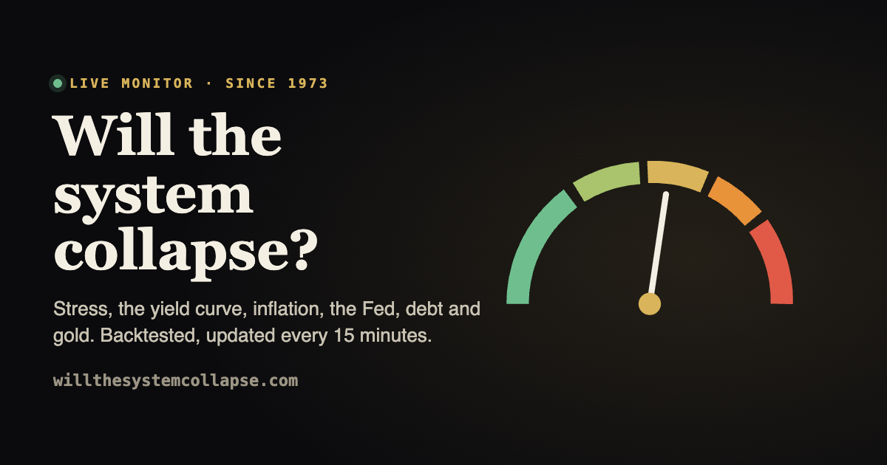

# willthesystemcollapse.com

[](https://willthesystemcollapse.com)
[](LICENSE)
[](https://creativecommons.org/licenses/by/4.0/)

[](https://willthesystemcollapse.com)

**A live 0–100 financial stress score, backtested since 1973.** It reads 230+ public series (Federal Reserve, FRED, US
Treasury, OFR, ECB, IMF, World Bank) every 15 minutes and answers one question: will the system collapse?

- **Backtested, not guessed:** five pillars, a recession model (out-of-sample AUC ≈ 0.90), and the historical odds of a crisis after months like this one.
- **Fair by rule:** the formula changes only when a change beats chance on data it wasn't fitted to; every change and every rejected idea is on record.
- **Open data:** everything on the page is one JSON file, [`/live/collapse.json`](https://willthesystemcollapse.com/live/collapse.json) (CC BY 4.0).
- **No black box, no ads, no financial advice:** stdlib Python and a static Astro page.

If it is useful, a ⭐ helps others find it.

A live, backtested gauge of how close the financial system is to breaking. A stdlib-Python collector pulls 230+ public
series into SQLite every 15 minutes, scores them (five pillars, backtested since 1973) and writes one JSON file that the
static Astro page polls. It also writes the live answer, score and summary into the built page, so the first paint and
crawlers see them before the script runs.

```
collector/      collect.py (fetch, write JSON, write the reading into the page), score.py (method, backtest),
                forecast.py (recession model), test_collapse.py (self-check), cron.sh (the server's cron entry)
src/pages/      index.astro (the whole monitor), about.astro, 404.astro; src/components/ header and footer
deploy/         deploy.sh (runs on the server), nginx.ssl.conf_live (copy of the server's nginx include)
public/live/    collector output, gitignored: collapse.json (this site) and why-gold.json (gold history)
```

## Local
```bash
npm ci
npm test                                   # scoring self-check
SSL_CERT_FILE=<system roots .pem> npm run collect   # refresh public/live/ from collector/data/collapse.db (gitignored)
npm run dev
```
python.org Python on macOS needs `SSL_CERT_FILE` pointing at the system roots for some government sites
(`security find-certificate -a -p /System/Library/Keychains/SystemRootCertificates.keychain > roots.pem`).
Deleting the database triggers a full backfill (~2 min).

## Production
A HestiaCP server; the site runs as its own Hestia user, `willthesystemcollapse`. Server access stays out of the repo:
`npm run deploy` reads the SSH target from `.secrets` (`DEPLOY_SSH=-p <port> <user>@<host>`, gitignored).

| What | Where |
|---|---|
| Web root | `~/web/willthesystemcollapse.com/public_html` (`www.` redirects to the apex) |
| Releases | `~/app/releases/<date>-<sha>` (last 3 kept, each with its built `dist/`) |
| Source clone | `~/app/repo` (public HTTPS clone of this repo) |
| Database | `~/app/data/collapse.db` (full history), errors in `~/app/data/collect.log` (capped at ~1 MB) |
| Live JSON | `public_html/live/` (deploys never touch it; served with CORS `*` and no-cache by `nginx.ssl.conf_live`) |
| Cron | Hestia cron job of the user, `*/15`: `sh ~/app/repo/collector/cron.sh` (flock, so runs never overlap) |
| TLS | Hestia Let's Encrypt (auto-renews), forced HTTPS, HSTS |
| Email in | MX → Postmark, inbound domain catches every address; Postmark posts each email to `/api/postmark-inbound.php` (`public/api/`), which forwards it through the Postmark API. Config: `~/web/willthesystemcollapse.com/private/postmark.ini` (mode 600, not in git) |

```bash
git push && npm run deploy   # deploy.sh builds origin/main into a fresh release, syncs dist/ into the web root,
                             # then writes the latest reading into the new page
```

Run the collector by hand as the site user: `sh ~/app/repo/collector/cron.sh` (`collect.py --force` ignores TTLs,
`--only KEY…` refreshes some series). Rollback, as the user:
`rsync -a --delete --exclude .well-known --exclude /live/ ~/app/releases/<release>/dist/ ~/web/willthesystemcollapse.com/public_html/`.
nginx caches open files for up to 60 s, so changes can take a minute to show.

Other sites read `/live/*.json` cross-origin, so keep their field names stable.

## Licence
Code: MIT (`LICENSE`). Our scores and derived data are [CC BY 4.0](https://creativecommons.org/licenses/by/4.0/); each underlying series stays
under its publisher's terms.
